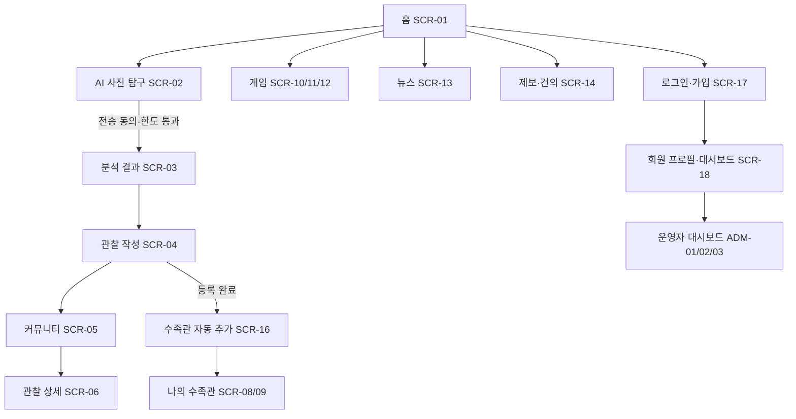

# 화면 설계 및 구현 대응표

Streamlit 기본 컴포넌트만 사용합니다. 카드/폼/탭은 `st.container`, `st.columns`, `st.form`, `st.tabs`, `st.expander`, `st.popover`로 구성합니다. 커스텀 CSS, `unsafe_allow_html`, `components.html`은 사용하지 않습니다.

| ID | 화면 | 구현 위치 | 접근 |
|---|---|---|---|
| SCR-01 | 홈 대시보드, 공개 관찰 미리보기, 물때 미니 배너 | `pages/home.py` | 공개 |
| SCR-02 | 사진 촬영·앨범 선택, 분석 동의·호출 횟수 | `pages/explore.py` | 공개, 세션별 한국 시간 기준 하루 3회 데모 제한 |
| SCR-03 | 생물 분석 결과, 확신도, 서식지·먹이·생태·질문 | `pages/explore.py` | 공개 |
| SCR-04 | 관찰 게시물 작성, 위치/게시물/사진 활용 동의 | `pages/community.py` | 회원 작성 |
| SCR-05 | 게시판 탭, 생물 필터, 최신/인기 정렬 | `pages/community.py` | 공개 읽기 |
| SCR-06 | 관찰 상세, 공감, 댓글, 작성자 수정·삭제 | `pages/community.py` | 공개 읽기, 회원 반응 |
| SCR-07 | 작성자 공개 프로필/도감 요약 | `pages/community.py`의 게시글 작성자 영역 | 공개 게시물에 한함 |
| SCR-08 | 수족관 목록, 검색, 잠금 종 | `pages/aquarium.py` | 회원 |
| SCR-09 | 도감 상세, 공개 상태, 관찰 기록·동의 철회 UI | `pages/aquarium.py` | 회원 |
| SCR-10 | 퀴즈/퍼즐 카드와 종별 Top 5 | `pages/games.py` | 공개 |
| SCR-11 | 해양생물 퀴즈 2문항 | `pages/games.py` | 공개, 회원 기록 SQLite 저장 |
| SCR-12 | 2×2 사진 퍼즐 | `pages/games.py` | 공개, 회원 기록 SQLite 저장 |
| SCR-13 | 해양 뉴스·칼럼 Top 5 | `pages/news.py` | 공개, 샘플 콘텐츠 |
| SCR-14 | 오류 제보·건의 접수 및 접수번호 확인 | `pages/reports.py` | 공개 |
| ADM-01 | 게시판 생성·권한·필드와 운영 현황 | `pages/admin.py` | 운영자 |
| ADM-02 | 사용자 정의 입력 항목 추가 | `pages/admin.py` | 운영자 |
| SCR-15 | 홈 물때 배너 지역 검색/변경 | `pages/home.py` | 공개 |
| SCR-16 | 게시 완료와 수족관 자동 추가 안내 | `pages/community.py` | 회원 |
| SCR-17 | 로그인·회원가입 데모 폼 | `pages/login.py` | 공개 |
| SCR-18 | 회원 활동 요약, 프로필·포인트 | `pages/dashboard.py`, `pages/profile.py` | 회원 |
| ADM-03 | 외부 연동 준비 상태 | `pages/admin.py` | 운영자 |

## 주요 이벤트와 상태

- 로그인/회원가입: 이메일 형식을 확인하고 데모 세션의 권한을 회원 또는 운영자로 설정합니다. 개발 설정에서만 데모 계정 전환기가 표시됩니다.
- AI 탐구: JPEG/PNG/WebP 및 파일 크기를 확인하고 Pillow로 방향을 보정·리사이즈·재인코딩하여 EXIF를 제거합니다. AI 전송 동의와 횟수 제한을 통과해야 결과를 표시합니다. 기본 개발 프로필에서는 샘플 결과를 사용합니다.
- 관찰 등록: 제목과 본문 필수, 기본 위치 비공개. 게시물 공개, 사진 공개, 운영자 사진 활용 동의는 별도 필드로 기록합니다. 사진 공개 동의가 없으면 사진을 저장하지 않고 텍스트 게시물은 등록 가능합니다.
- 게시 완료: 관찰 행 저장 후 같은 트랜잭션에서 종을 수족관에 추가합니다. 중복 종은 수집 행을 중복 생성하지 않습니다.
- 게시물/댓글/제보: SQLite에 저장합니다. 작성자 본인만 관찰을 편집·삭제하고 운영자는 관리 삭제를 할 수 있습니다.
- 운영자: AI 통계는 샘플 집계, 게시판 설정은 현재 세션에 반영됩니다. 변경 이력과 실제 계정 권한 연결은 외부 인증 어댑터가 필요합니다.

## 흐름

## 구현 한계

화면 시안 자체가 계정 인증, Gemini 실제 호출, GPS 자동 추출, 해양 관측 API, Jira, 뉴스 수집, 영구 포인트 정책은 미연동으로 표시합니다. 개발 화면은 예시 데이터와 로컬 SQLite를 사용하며 외부 전송을 하지 않습니다. 사진은 EXIF 제거 후 로컬 SQLite에만 저장됩니다.
